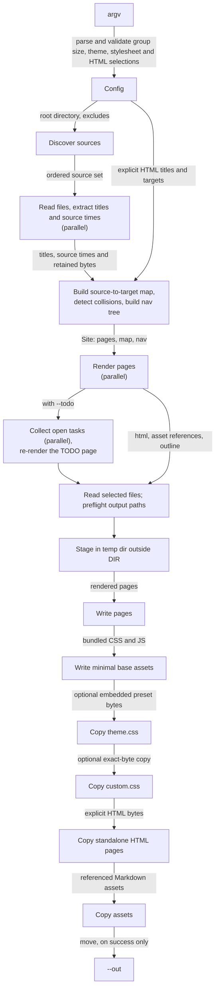
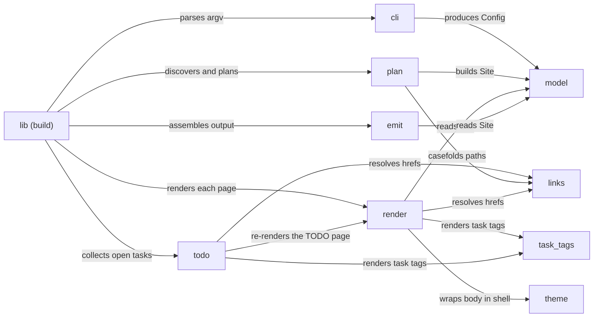

# Architecture

`ohimark` is a single-shot static site generator: one process reads a directory of
Markdown and writes a directory of HTML, CSS, JS and SVG. It shells out to no external
binary and makes no network request. Mermaid diagrams are rendered in-process, so the
built site ships no diagram runtime at all. An optional author-supplied stylesheet and
explicit standalone HTML pages are copied unchanged; any resources they reference are
the author's responsibility.

[Requirements](requirements.md) specifies the behaviour; this document describes the
shape of the code that produces it.

## Pipeline

Build phases are strictly ordered. The structural fact that shapes everything else is the
split between **planning** and **rendering**: every page's target path must be known
before any page is rendered, because resolving a link needs the complete source-to-target
map. Planning therefore reads every file up front — it needs each one's first heading for
its title anyway — and retains the bytes for the render pass that follows.

## Modules

| Module | Responsibility | Key items |
| --- | --- | --- |
| `cli` | clap definitions; validates and normalises argv into a `Config`, including sidebar group size and explicit HTML titles and destinations | `Args`, `Config`, `HtmlPage`, `PresetTheme` |
| `model` | shared domain types, errors, and the warning sink; no I/O | `SourceRel`, `TargetPath`, `Page`, `Site`, `NavNode`, `Warnings` |
| `plan` | ignore-aware walk, `--exclude` overrides, source-to-target mapping, collision detection, root-file resolution, titles, nav tree | `plan()` |
| `render` | Markdown event stream to HTML; anchors, outline, code fences, Mermaid | `render_page()`, `render_part()` |
| `task_tags` | recognizes tag groups in a task item's own paragraph prose and renders badges plus filter metadata | shared task-tag parser and renderer |
| `links` | relative reference resolution, plus the POSIX path helpers it needs | `resolve()`, `fold()`, `normpath()`, `relpath()` |
| `theme` | page shell, sidebar, outline rail; marks the final TODO article; minimal base CSS and JS; embedded presets; optional theme and custom stylesheet links | `shell()`, `STYLE_CSS`, `APP_JS` |
| `emit` | output collision preflight, temp staging, preset and custom stylesheet copies, referenced asset and explicit HTML copies, move into `--out` | `emit()` |
| `todo` | `--todo`: lifts open task items out of every page, groups them by source, and appends them to the root TODO page | `collect()`, `render_page()` |

Nine modules and a `lib.rs` that sequences them. Discovery lives in `plan` because a
source set is only useful once it has been mapped to targets; Mermaid lives in `render`
because it is one more fence handler; the path helpers live in `links` because resolution
is what needs them.

## Core types

- `SourceRel` — a `DIR`-relative POSIX path to an input file.
- `TargetPath` — an output-relative path, ending in `.html` for a rendered Markdown page; explicit HTML selections preserve their filename.
- `HtmlPage { title, source, target }` — an explicit standalone input, with a canonical absolute UTF-8 source and an output-relative destination.
- `Page { source, target, title, times }` — one rendered document. `PageTimes { created, modified }` holds optional source-file creation and modification times; unsupported filesystem timestamps remain unknown, and synthetic pages have neither time.
- `Site { pages, by_source, nav, todo }` — `by_source` is the casefolded map `links` resolves against; `todo` is the index of the root TODO page when `--todo` is set and there is one (a root TODO file, or a synthetic page because some page has an open task).
- `NavNode` — either a page entry or a group carrying a label, an optional link, and children.
- `Warnings` — an ordered sink; everything in it reaches stderr and nothing in it affects the exit code.

The public `Args` and `Config` structs expose the optional stylesheet path as
`stylesheet` (`Option<PathBuf>` and `Option<Utf8PathBuf>`, respectively), and the
optional `theme` as `Option<PresetTheme>`. `Args.html_pages` contains the repeated raw
title/path values, while `Config.html_pages` is an ordered `Vec<HtmlPage>`.
`PresetTheme` and `HtmlPage` are re-exported from the crate root. Code that constructs
either struct with a literal must provide these fields (`None` or an empty vector when
unused).

`--max-group-size` is validated as a positive `u32`, defaults to `10`, and uses the last
value when repeated. `Config` carries this value to the page shell, which exposes it on
the main navigation as `data-ohm-max-group-size` for the browser enhancement.

## Standalone HTML pages

The CLI validates each `--endpoint TITLE PATH` pair independently of the source walk.
Titles must be nonblank UTF-8 text. Paths must be UTF-8 before and after canonicalisation
and name readable regular files. A canonical source under `DIR` retains its relative
path and case; an external source uses the supplied filename at the output root.

Planning appends a `NavNode::Page` for each selection after the Markdown navigation,
preserving command-line order. Explicit selections remain separate from `Site.pages`
and retained Markdown source texts; ordinary discovery still processes eligible files
independently and registers in-tree HTML assets in `by_source`. The existing shell
escapes their titles and computes percent-encoded relative sidebar URLs from each
rendered page's output directory, including a relocated root. Explicit HTML copies
bypass Markdown rendering and TODO extraction.

Output assembly reads their bytes and checks casefolded exact and component-boundary
ancestor/descendant collisions against rendered pages, other explicit HTML selections,
referenced assets, bundled CSS and JS, and enabled preset/custom CSS. An exact asset
match is allowed only for the same canonical source. After preflight, selected bytes are
staged unchanged with the rest of the site. Read, collision, or write failures leave
`--out` absent or empty. HTML resource references are not parsed, copied, or rewritten;
authors provide dependencies at paths suitable for each HTML file's output location.

## Rendering a page

One pass over the Markdown event stream, with six interceptions:

1. **Link and image tags** go to `links::resolve`. An image additionally registers a referenced asset, which is what causes that file to be copied.
2. **Headings** receive an anchor identifier, slugged from the text and deduplicated within the page by a numeric suffix, and are recorded for the outline.
3. **A fence tagged `mermaid`** is rendered to SVG, alongside the retained source.
4. **Any other fence** becomes `<pre><code class="language-…">` with its content escaped and otherwise verbatim.
5. **Task-list items** are emitted with a class on the `<li>` so the stylesheet can suppress the marker. This is determined by looking ahead, since the checkbox sits inside a paragraph in loose lists.
6. **Task tags** are recognized from source-backed inline events in a task item's own paragraph prose. The shared helper removes valid brace groups, renders escaped badges at the end of the first label paragraph, and attaches lowercase JSON keys to tagged tasks. Ordinary pages and collected tasks use the same helper; the collector keeps item boundaries until it has pruned checked descendants, so nested task text cannot leak into its parent's tags.

Each static badge carries `data-ohm-tag-color`: FNV-1a32 of the lowercase key's UTF-8
bytes modulo eight selects a stable palette slot. CSS gives tags square corners and
faded theme colors; badge colors need no browser state or JavaScript.

`theme::shell` then wraps the result, taking the nav tree, the page's outline and its body.
It retains its public signature and emits the base-only page shell. During output assembly,
an internal helper adds relative links for the selected preset and custom stylesheet after
the base stylesheet, in that order, adjusted for the page's output depth.

## Sidebar sorting

Planning captures each source file's creation and modification timestamps alongside its
title. Rendering exposes available values on sidebar page and subgroup rows as epoch
milliseconds; unknown timestamps are omitted. A subgroup's creation time is the earliest
known time among all descendant pages and its modification time is the latest known time,
including its linked landing page. Unknown page times do not affect aggregation; if no
descendant has a known time, the group time is unknown. Synthetic pages have no date values.

The browser script enhances each group with at least two immediate rows (pages or
subgroups) by adding a native sort chooser. Selected modes sort all those rows together by
displayed page title or subgroup heading, or by their timestamps. Moving a subgroup leaves
its contents and its independent sort preference intact; the root page stays pinned.
Default restores the planner's pages-first filename order followed by alphabetical
subgroups. Date ties use ascending natural displayed title or heading and then original
row order; missing dates sort last in both directions.

The script stores each non-default choice in `sessionStorage`, keyed by the resolved site
root and the group's directory path, independently from collapse state. It validates
stored choices, removes obsolete values and treats storage as best-effort so a storage
failure still allows sorting in the current page. Since the chooser is inserted by
JavaScript, a page without JavaScript keeps its default navigation without an inert control.

## Sidebar group scrolling

The page shell exposes the configured `--max-group-size` on the main navigation as
`data-ohm-max-group-size`. With JavaScript enabled, the browser measures the rendered
height of each group's first N immediate page and subgroup rows after theme styling and
text wrapping, then limits the initial visible area to those rows. Extra rows remain
reachable by vertical scrolling. Separate top and bottom `...` cues appear independently
while more content remains above or below: bottom only at the start, both in the middle,
and top only at the end. Each has a fixed accessible description. Inactive cues retain
their layout slots while capped but are hidden from assistive technology and pointer
input, so changing direction does not move rows or alter ancestor geometry or scrolling.
Uncapping removes both slots from layout. Nested groups are measured independently.
Sorting, reopening a group, and resizing the sidebar recalculate the visible area.
A directory heading is outside its child-row
limit; the top-level list keeps its viewport scrolling and pinned root page. Without
JavaScript, the complete native navigation stays available without a group cap.

## Custom stylesheet

The bundled stylesheet is a minimal base that preserves the navigation, panel and diagram
scaffold while leaving typography, color and element defaults to the browser. The optional
`--theme default` and `--theme bookish` selections copy the embedded bytes of
`themes/default.css` or `themes/bookish.css` to `assets/theme.css`; no runtime theme file is
needed. Without a selected theme or custom stylesheet, output keeps the browser-native
defaults. The normal Nix package CLI accepts `--theme`; docs and watchdocs builders pass
their configured theme through the same flag to that binary. The docs call accepts
`theme = "default"`, `theme = "bookish"`, or `theme = null`; its default is `null`, while
the repository flake selects the default theme. Presets need no runtime theme files.
The separate optional `stylesheet` argument remains a custom override: it accepts an
in-repository Nix path, repository-relative path string, or `null`, and is linked after
the selected preset. The configured theme and stylesheet apply to sealed and live outputs;
watchdocs also reflects edits to the configured custom stylesheet.

`--stylesheet` selects one local CSS file from outside or inside `DIR`; it is independent
of Markdown discovery and ignore rules. The supplied path and its canonical path must be
UTF-8, and the path must name a readable regular file. The file contents may be arbitrary
bytes and are preserved unchanged.
Once rendered destinations are known, a selected custom file is read once and output
assembly checks each enabled reserved path (`assets/theme.css` and `assets/custom.css`) for
casefolded exact or component-boundary ancestor/descendant conflicts with emitted pages or
referenced Markdown assets. Unreferenced non-Markdown assets do not conflict. A conflict
aborts the build before staging. Otherwise the selected preset bytes and custom stylesheet
bytes are copied unchanged into the stage before publication. Read, write or collision
failures leave `--out` absent or empty.

The CSS is not parsed or rewritten. `url()` and `@import` dependencies are not copied or
fetched; relative URLs resolve from the CSS file's output path (`assets/theme.css` or
`assets/custom.css`), so authors must include or provide referenced resources in a way
that keeps the output portable and usable offline.

## Collecting tasks

With `--todo`, `plan` picks the root TODO page before building the source map and the
nav: a top-level `TODO.md` (or `TODO.markdown`, casefolded) if it is a page, otherwise a
synthetic `TODO.md` page targeting `TODO.html`, whose source is just `# TODO`. A root
TODO file that is excluded, ignored or unreadable is not a page, so it gets the synthetic
one too. The synthetic page is only added when some page has an open task
(`todo::has_open_task`): with none there is nothing to collect, so no TODO page is
planned, nothing joins the nav and `TODO.html` is not generated. When it is added, a file
in `DIR` already at `TODO.html` is a planning error rather than something to overwrite.
The synthetic page has no file behind it, which is safe because nothing after planning
reads a page's source from disk; it flows through link resolution, the collision check
and the nav like any other page.

After the render pass, `todo` re-parses every other page with the same parser options
and lifts each unchecked task item out whole, dropping any checked task items nested in
it. An unchecked item inside a dropped subtree is lifted on its own, right after the item
it was dropped from, so none is lost. Each source heading and its rendered task list are
wrapped in a `data-ohm-todo-group` section; the optional `Collected Tasks` appendix has a
`data-ohm-todo-collected` wrapper. Links and images inside a lifted item are resolved
from its own page's source directory but against the TODO page's target directory, and
the assets they hit are recorded so `emit` copies them. A fragment link is pointed back at
the item's own page, a missing target is re-based lexically, and a footnote reference
becomes plain text, since its definition stays behind. Each item is serialised to a
single line of HTML, so a file's items can be appended as one raw-HTML list. Lifting
works on the Markdown, not the page's rendered HTML, so a `mermaid` fence inside a lifted
task comes out as an ordinary code block, not a diagram.

The lifted items then form an appendix: an h2 per file with open tasks, in deterministic
page order (casefolded source path, R1.6), linking to that file's source path and followed
by its items, behind a `# Collected Tasks` heading when the page is a real `TODO.md`. Each
group carries the same safe `data-ohm-created` and `data-ohm-updated` epoch-millisecond
attributes as its sidebar entry when available; unknown or unsafe values are omitted.
There are no directory headings. When nothing was collected the appendix is empty,
heading included, and is skipped, so a real `TODO.md` renders as it does without `--todo`.
The TODO page is rendered again in two parts, its own Markdown and the appendix. Each
part is parsed separately so a fence or HTML block left open in `TODO.md` cannot swallow
the appendix. The parts share one `PageIds`, so heading anchors and
diagram ids stay unique across both; their HTML and outlines are joined. The generated
headings get anchors and outline entries, and their links resolve normally. The re-render
replaces the first one, warnings included, so nothing is reported twice. Nothing is
written to `DIR`: the appendix exists only in memory.

The shell marks only the planned TODO page's article with `data-ohm-todo`, using its
unique output target so a TODO page selected as `--root` is marked after it becomes
`index.html`. The browser script uses that marker to add one compact search line with
up to two visible removable selected tags, a `+N` overflow count, Clear and an `N/T`
direct-match count. It searches available tag names using exact, prefix, substring and
subsequence matching, ignoring case and accents, in a popup limited to eight rows.
Typing alone leaves task visibility unchanged; pointer selection or Arrow Up/Down and
Enter adds a tag, and Escape closes the popup. The catalog, suggestions and selections
copy labels and palette slots from each task's own static badges. Selected tags filter tasks with
OR matching while retaining matching nested tasks' ancestors; no selection shows all
tasks. Empty generated groups hide with their outline links. Selection resets on reload.
The complete list and badges remain available without scripting.

## Mermaid

`merman` parses, lays out and renders Mermaid entirely in Rust — no Node, Puppeteer or
Chromium. Each diagram is rendered **once**. Its colour literals are then rewritten into
CSS custom properties, so a single inline SVG is correct in both light and dark modes and
the theme toggle needs no JavaScript; `max-width: 100%` with `height: auto` scales it to any
viewport, also without JavaScript. A diagram that fails to render warns and falls back to
an ordinary code block.

Diagram text uses `--ohm-font-sans` at 14px, with node and rank spacing tightened from
Mermaid's defaults. The base uses the browser's native serif font stack; an optional preset
can override it. `merman` sizes each label with a heuristic that ignores the font family,
so node padding is the only margin against a label overflowing its box. Gantt charts are
the exception: `merman` only computes their layout (bar positions and axis ticks), while
ohimark's own minimal renderer draws the SVG from it.
Every section and task label sits in a left column, the chart area holds nothing but
unoutlined bars, and a single axis with date ticks runs along the bottom. That SVG carries
no colours of its own, only classes styled by the bundled diagram rules to use the active
palette.

Diagram layout is the most expensive thing the build does, which is what makes the
parallel render pass worth having.

## Parallelism

Three phases fan out across `rayon`, and all are pure functions of their inputs:

- **Read and title** — each source file is read once, its first heading extracted, and its
  available filesystem timestamps captured.
- **Render** — each page is rendered independently, Mermaid layout included.
- **Collect tasks** — with `--todo`, each page's open tasks are lifted out independently.

Everything order-sensitive stays ordered. `par_iter().map().collect()` preserves input
order, so the page vector is deterministic regardless of thread scheduling. Collision
detection, asset-reference merging and warning emission all run *after* their parallel
phase, walking results in page order — a stable page order and stable stderr cost nothing
once the parallel phase is over, and they keep diffs between builds readable. Discovery
itself is already deterministically ordered (R1.6); this just carries that order through
the rest of the pipeline.

## Output assembly

The site is written into a temporary directory outside `DIR` and moved into `--out` only
once complete, so a failed build never leaves a half-written output directory. `--out`
may sit inside `DIR`; discovery excludes it so a rebuild never ingests its own output.

The Nix docs bundle builds this repository's library API with the pinned compiler and
existing Cargo vendoring, running `cargo doc --offline --locked --no-deps --lib`.
The shared renderer passes `--endpoint 'API'` with a stable `cargo-docs.html`
landing file, which redirects and provides a fallback link to
`cargo-docs/ohimark/index.html`. Since an endpoint copies only its selected file,
`nix/docs.nix` explicitly bundles the full rustdoc resource tree under `cargo-docs/`;
dependency APIs are omitted. The existing `nix build path:.#docs`, `nix run path:.#docs`,
and `watchdocs` outputs share this bundle. Live Markdown and custom stylesheet edits
still re-render normally, while API docs remain an immutable Nix snapshot: restart
`nix run` after Rust source changes to rebuild the executable and Cargo API docs.

## Dependencies

| Crate | Used for |
| --- | --- |
| `clap` (derive) | command-line parsing |
| `ignore` | gitignore-aware walk; its `OverrideBuilder` also implements `--exclude` |
| `camino` | UTF-8 paths end to end |
| `thiserror` | domain errors in `model` |
| `pulldown-cmark` | CommonMark and GFM table parsing |
| `merman` | Mermaid to SVG, in-process, required at `0.8.0-alpha.6` or compatible |
| `rayon` | data parallelism across the read, render and task-collection phases |
| `percent-encoding` | href decoding and encoding |
| `tempfile` | staging directory |

No `build.rs`, no vendored JavaScript, and no network access by ohimark at build or run
time. Base CSS, JS, and built-in presets are embedded source files; an author's custom CSS
may reference external resources, which ohimark does not inspect or fetch.

Dropped with the mdBook-era design: the `mdbook`, `mdbook-mermaid`, `static-web-server`
and `watchexec` binaries; `lol_html`, which existed only to rewrite links in already-built
HTML; and `command-group` with `signal-hook`, which supervised the child processes that
`serve` and `watch` spawned.

## Why it is shaped this way

- **Plan before render** — link resolution needs every target up front, so the page set cannot be discovered lazily. (R6)
- **Resolve during render, not after** — the parser already yields links as events; a second parse of generated HTML would buy nothing and cost a dependency. (R6)
- **Copy referenced assets and explicit inputs** — the render pass discovers Markdown asset references; selected preset/custom CSS and standalone HTML pages are copied by `emit` independently of discovery. (R5, R13)
- **Stage then move** — the only way a failed build can leave `--out` untouched. (R10.2)
- **One SVG per diagram** — a second themed render would double the build's most expensive step to save a colour-rewriting pass over its output. (R8.2)
- **Parallel where it is pure, ordered where it is observable** — the expensive phases are independent per page, and every order-sensitive step is deferred until after them, so builds stay easy to diff. (R1.6)
