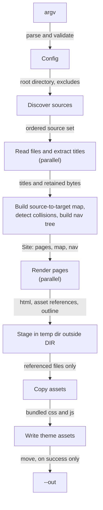
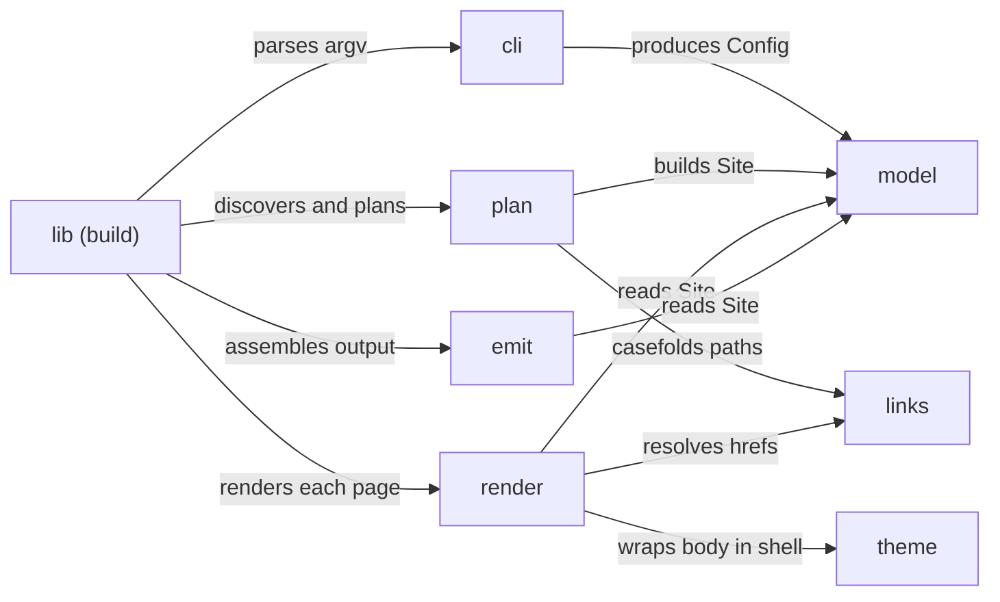

# Architecture

`ohimark` is a single-shot static site generator: one process reads a directory of
Markdown and writes a directory of HTML, CSS, JS and SVG. It shells out to no external
binary and makes no network request. Mermaid diagrams are rendered in-process, so the
built site ships no diagram runtime at all.

[Requirements](requirements.md) specifies the behaviour; this document describes the
shape of the code that produces it.

## Pipeline

Five stages, strictly ordered. The structural fact that shapes everything else is the
split between **planning** and **rendering**: every page's target path must be known
before any page is rendered, because resolving a link needs the complete source-to-target
map. Planning therefore reads every file up front — it needs each one's first heading for
its title anyway — and retains the bytes for the render pass that follows.

## Modules

| Module | Responsibility | Key items |
| --- | --- | --- |
| `cli` | clap definitions; validates and normalises argv into a `Config` | `Args`, `Config` |
| `model` | shared domain types, errors, and the warning sink; no I/O | `SourceRel`, `TargetPath`, `Page`, `Site`, `NavNode`, `Warnings` |
| `plan` | ignore-aware walk, `--exclude` overrides, source-to-target mapping, collision detection, root-file resolution, titles, nav tree | `plan()` |
| `render` | Markdown event stream to HTML; anchors, outline, code fences, Mermaid | `render_page()` |
| `links` | relative reference resolution, plus the POSIX path helpers it needs | `resolve()`, `fold()`, `normpath()`, `relpath()` |
| `theme` | page shell, sidebar, outline rail; bundled CSS and JS | `shell()`, `ASSETS` |
| `emit` | temp staging, asset copy, move into `--out` | `emit()` |

Seven modules and a `lib.rs` that sequences them. Discovery lives in `plan` because a
source set is only useful once it has been mapped to targets; Mermaid lives in `render`
because it is one more fence handler; the path helpers live in `links` because resolution
is what needs them.

## Core types

- `SourceRel` — a `DIR`-relative POSIX path to an input file.
- `TargetPath` — an output-relative path, ending in `.html` for a page.
- `Page { source, target, title }` — one rendered document.
- `Site { pages, by_source, nav }` — `by_source` is the casefolded map `links` resolves against.
- `NavNode` — either a page entry or a group carrying a label, an optional link, and children.
- `Warnings` — an ordered sink; everything in it reaches stderr and nothing in it affects the exit code.

## Rendering a page

One pass over the Markdown event stream, with four interceptions:

1. **Link and image tags** go to `links::resolve`. An image additionally registers a referenced asset, which is what causes that file to be copied.
2. **Headings** receive an anchor identifier, slugged from the text and deduplicated within the page by a numeric suffix, and are recorded for the outline.
3. **A fence tagged `mermaid`** is rendered to SVG, alongside the retained source.
4. **Any other fence** becomes `<pre><code class="language-…">` with its content escaped and otherwise verbatim.

`theme::shell` then wraps the result, taking the nav tree, the page's outline and its body.

## Mermaid

`merman` parses, lays out and renders Mermaid entirely in Rust — no Node, Puppeteer or
Chromium. Each diagram is rendered **once**. Its colour literals are then rewritten into
CSS custom properties, so a single inline SVG is correct under both themes and the theme
toggle needs no JavaScript; `max-width: 100%` with `height: auto` scales it to any
viewport, also without JavaScript. A diagram that fails to render warns and falls back to
an ordinary code block.

Diagram layout is the most expensive thing the build does, which is what makes the
parallel render pass worth having.

## Parallelism

Two phases fan out across `rayon`, and both are pure functions of their inputs:

- **Read and title** — each source file is read once and its first heading extracted.
- **Render** — each page is rendered independently, Mermaid layout included.

Everything order-sensitive stays ordered. `par_iter().map().collect()` preserves input
order, so the page vector is deterministic regardless of thread scheduling. Collision
detection, asset-reference merging and warning emission all run *after* their parallel
phase, walking results in page order — so one tree always produces the same site and the
same stderr, which is what R11.3 requires.

## Output assembly

The site is written into a temporary directory outside `DIR` and moved into `--out` only
once complete, so a failed build never leaves a half-written output directory. `--out`
may sit inside `DIR`; discovery excludes it so a rebuild never ingests its own output.

## Dependencies

| Crate | Used for |
| --- | --- |
| `clap` (derive, env) | command-line parsing |
| `ignore` | gitignore-aware walk; its `OverrideBuilder` also implements `--exclude` |
| `camino` | UTF-8 paths end to end |
| `anyhow` | error context |
| `thiserror` | domain errors in `model` |
| `pulldown-cmark` | CommonMark and GFM table parsing |
| `merman` | Mermaid to SVG, in-process, pinned at `0.8.0-alpha.6` |
| `rayon` | data parallelism across the read and render phases |
| `percent-encoding` | href decoding and encoding |
| `tempfile` | staging directory |

No `build.rs`, no vendored JavaScript, no network access at build or run time. Theme CSS
and JS are source files embedded with `include_str!`.

Dropped with the mdBook-era design: the `mdbook`, `mdbook-mermaid`, `static-web-server`
and `watchexec` binaries; `lol_html`, which existed only to rewrite links in already-built
HTML; and `command-group` with `signal-hook`, which supervised the child processes that
`serve` and `watch` spawned.

## Why it is shaped this way

- **Plan before render** — link resolution needs every target up front, so the page set cannot be discovered lazily. (R6)
- **Resolve during render, not after** — the parser already yields links as events; a second parse of generated HTML would buy nothing and cost a dependency. (R6)
- **Only referenced assets are copied** — the render pass is what discovers references, so the asset set falls out of rendering rather than needing its own traversal. (R5)
- **Stage then move** — the only way a failed build can leave `--out` untouched. (R10.2)
- **One SVG per diagram** — a second themed render would double the build's most expensive step to save a colour-rewriting pass over its output. (R8.2)
- **Parallel where it is pure, ordered where it is observable** — the expensive phases are independent per page, and every order-sensitive step is deferred until after them. (R11.3)
