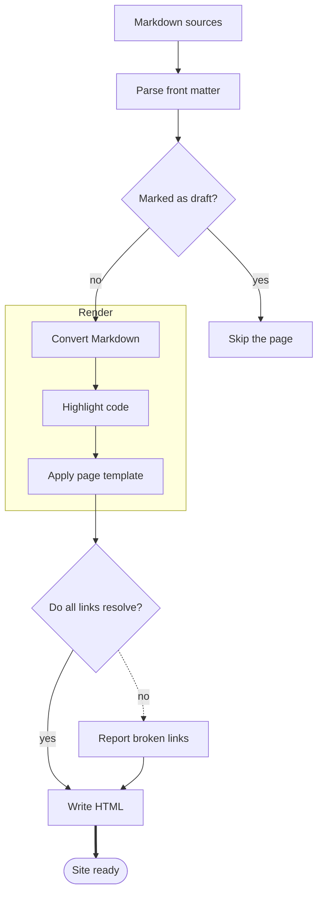
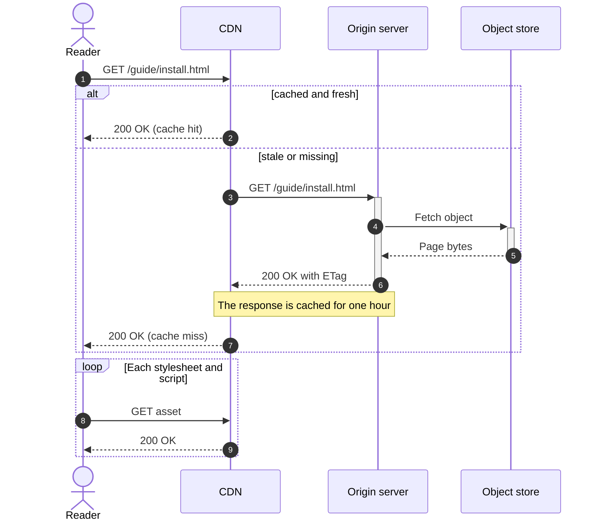
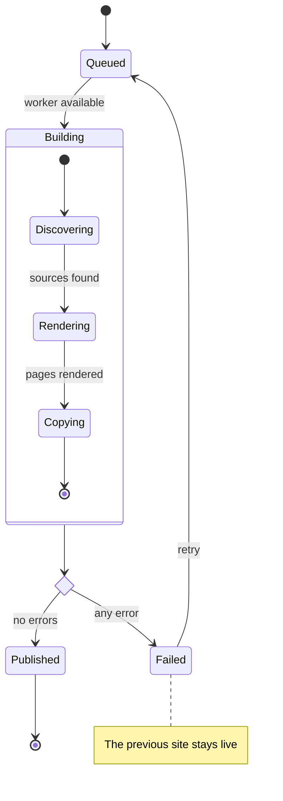
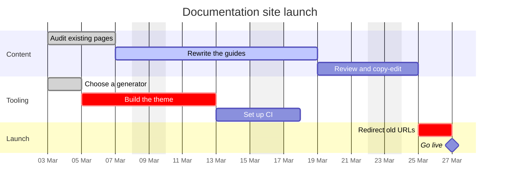
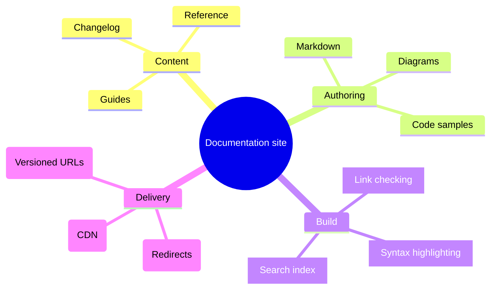
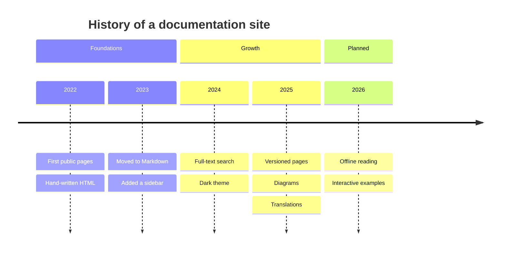
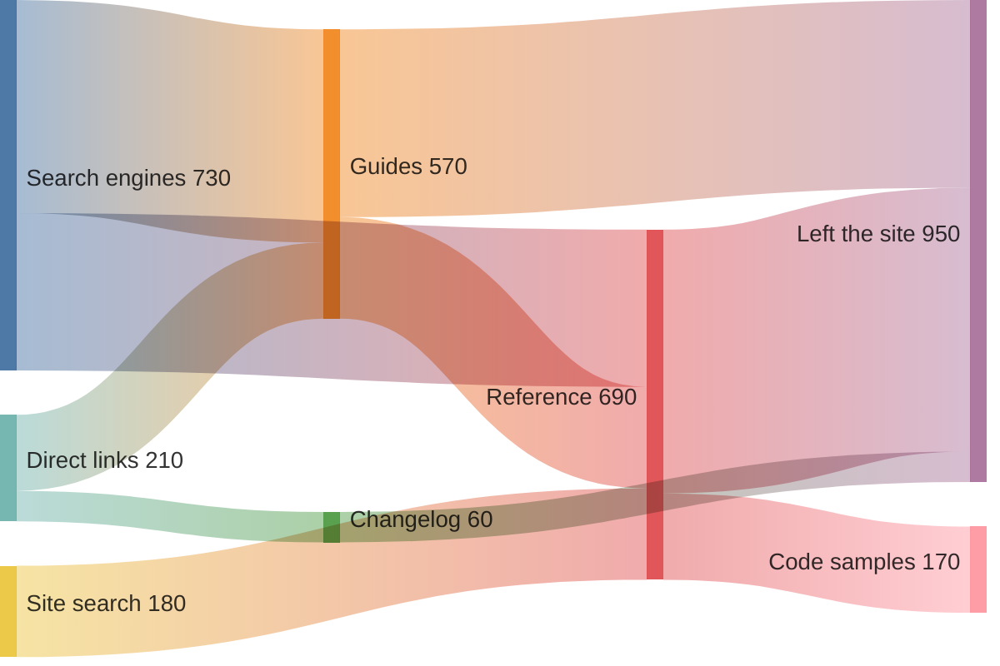
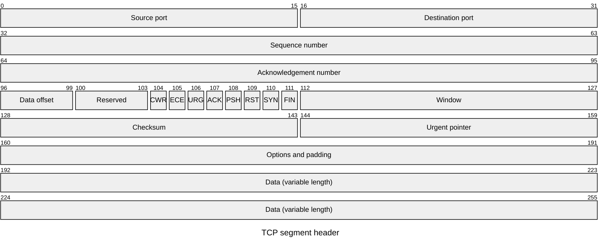
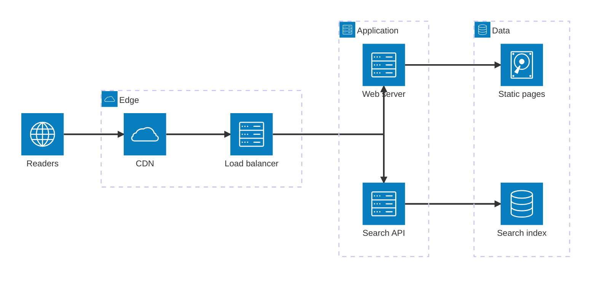

# Diagrams

A gallery of example Mermaid diagrams, one for each diagram type. Every example is a
fenced `mermaid` block in the Markdown source, rendered to inline SVG at build time.

## Codeblock
```bash
> echo $SUPER_SECRET_KEY
> echo "Done deal!"
```

## Flowchart

A flowchart shows the steps of a process and the decisions that route between them.



## Sequence diagram

A sequence diagram shows the messages that pass between participants, in the order they
are sent.



## State diagram

A state diagram shows the states a system can be in and the events that move it from one
to the next.



## Gantt diagram

A Gantt diagram lays tasks out against a calendar, showing how long each takes and what it
depends on.



## Swimlanes diagram

A swimlanes diagram is a flowchart divided into lanes, showing who owns each step and
where work is handed over.

```mermaid
swimlane-beta LR
  subgraph Author
    draft[Write draft]
    revise[Address comments]
  end
  subgraph Reviewer
    review{Changes needed?}
    approve[Approve change]
  end
  subgraph CI
    build[Build site]
    check[Check links]
  end
  subgraph Hosting
    publish([Publish])
  end
  draft --> review
  review -->|Yes| revise
  review -->|No| approve
  revise --> approve
  approve --> build --> check --> publish
```

## Mindmap

A mindmap arranges ideas as a tree that branches outwards from one central topic.



## Timeline diagram

A timeline diagram sets events out in chronological order, grouped into periods.



## Sankey

A Sankey diagram shows how a quantity flows between stages, with the width of each link
proportional to its volume.



## Packet diagram

A packet diagram shows the layout of a binary structure, such as a network packet, field
by field.



## Architecture diagram

An architecture diagram shows the services that make up a system, how they are grouped,
and how they connect.


