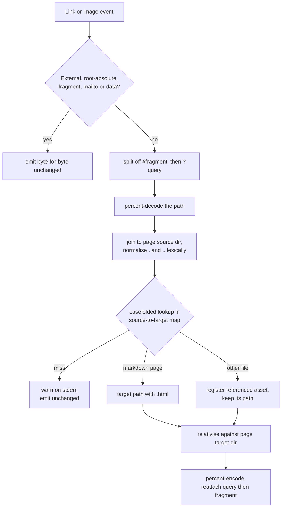

# Link and asset resolution

`ohimark` turns the relative references an author writes against Markdown *sources* into
relative URLs that work between rendered *pages*. This document describes that algorithm.
[Requirements](requirements.md) R2.7, R5.1–R5.4 and R6.1–R6.9 specify the behaviour it
must produce.

## Why it is needed

Two things make an authored reference differ from the URL that must be emitted:

1. **Extensions.** A link is written to `guide.md`; the page is served at `guide.html`.
2. **The root file.** Exactly one page is renamed: `--root` (default `README.md`) is
   emitted as `index.html` at the output root. Every other page keeps its path.

When `--root` names a file inside a subdirectory, that page's *source* directory and its
*target* directory differ — the only case in the system where they do. Its references were
authored against the subdirectory but must resolve from the output root.

## When it runs

During rendering, not after. The Markdown parser already yields links and images as
events, so resolution is a handler on that event stream; generated HTML is never parsed a
second time.

## Inputs

- **The source-to-target map**, built by `plan` before any page renders: casefolded
  `DIR`-relative source path to target path. It must be complete before rendering starts,
  which is why planning is a separate pass.
- **The page's source directory** — what the author wrote relative to.
- **The page's target directory** — what the emitted URL must be relative to. Identical to
  the source directory for every page except a subdirectory root file.

## The algorithm

1. Bail out on references that are not ours to touch (see the table below), emitting them byte-for-byte.
2. Split the fragment at the first `#`, then split the query at the first `?` of what remains.
3. Percent-decode the path.
4. Join it to the page's source directory and resolve `.` and `..` **lexically** — the filesystem is never consulted, so a symlink cannot redirect a link.
5. Casefold the result and look it up in the map.
   - **A Markdown page** — take its target path with the `.html` extension.
   - **A non-Markdown file** — register it as a referenced asset and keep its path.
   - **No match** — warn on stderr naming the referencing page and the target, and emit the reference unchanged.
6. Relativise against the page's target directory.
7. Percent-encode, then reattach the query and the fragment, in that order.

## Never touched

| Form | Example |
| --- | --- |
| Absolute URL | `https://example.com/x` |
| Protocol-relative | `//example.com/x` |
| Root-absolute | `/absolute/path.md` |
| Pure fragment | `#section` |
| `mailto:` | `mailto:a@b.com` |
| `data:` | `data:text/plain,hi` |

## Casefolding

Lookups are case-insensitive. That is what makes `Readme.md` and `readme.md` in one
directory a collision (R2.5), and what lets a link written `GUIDE.MD` find `guide.md`.
Folding applies to map keys and lookups only, never to emitted paths — output preserves
each source's own spelling.

## Assets

A link or image resolving to a non-Markdown file is the *only* thing that marks that file
for copying (R5.1). An asset referenced from two pages is registered twice and copied
once. A reference resolving outside `DIR` is never copied and warns.

## Failure is never fatal

Every unresolvable reference is a warning on stderr; the build continues and the href is
left exactly as written. `ohimark` does not invent destinations, and it does not fail a
build over a broken link.
